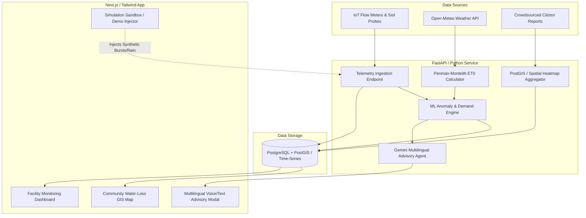

# 💧 JalRakshak AI (जल रक्षक)
### Intelligent Water Waste Prevention, Anomaly Detection & Community Conservation Ecosystem

> **Problem**: Trillions of liters of fresh water are wasted daily through unmonitored creeping leaks, over-irrigation of landscapes and crops, and poor watering schedules decoupled from local weather patterns.  
> **Innovation**: An end-to-end AI-driven water intelligence platform that learns usage patterns, accurately predicts water demand, detects invisible leaks in real time, guides users in their native language through GenAI, and mobilizes communities via a collaborative water-loss map.

---

## 📌 Table of Contents
1. [Core Problem & The JalRakshak Solution](#1-core-problem--the-jalrakshak-solution)
2. [Key Pillars & Technical Innovation](#2-key-pillars--technical-innovation)
   - [GenAI: Vernacular Voice & Text Copilot](#pillar-1-genai-vernacular-advisory)
   - [Machine Learning: Demand Forecasting & Leak Anomaly Engine](#pillar-2-machine-learning-demand-forecasting--leak-detection)
   - [Data Science: Weather & Evapotranspiration Integration](#pillar-3-data-science-weather--evapotranspiration-analytics)
   - [Web/App Dashboard: Real-time Telemetry & Savings](#pillar-4-webapp-analytics--action-dashboard)
3. [Unique Feature: Community Water-Loss Map](#3-unique-feature-community-water-loss-map)
4. [System Architecture & Data Flow](#4-system-architecture--data-flow)
5. [Target Segments & Measurable Impact](#5-target-segments--measurable-impact)
6. [Recommended Tech Stack](#6-recommended-tech-stack)
7. [Step-by-Step Execution Plan (Roadmap)](#7-step-by-step-execution-plan-roadmap)
8. [Demo & Simulation Scenarios](#8-demo--simulation-scenarios)
9. [Data Schemas & API Specifications](#9-data-schemas--api-specifications)

---

## 1. Core Problem & The JalRakshak Solution

### The Triad of Water Wastage
* **Invisible Leaks**: Toilet flappers, underground drip line pinholes, and faulty float valves waste up to 20–35% of facility water unnoticed, especially during off-peak hours (1 AM – 4 AM).
* **Blind Over-Irrigation**: Lawns, gardens, and crop patches are irrigated on static timers or manual habits regardless of soil moisture saturation or forecasted monsoon showers.
* **The Telemetry & Language Barrier**: Raw sensor telemetry ($m^3/\text{hr}$, kilopascals, matric suction) is inaccessible to rural farmers, school custodians, and everyday homeowners who need clear guidance in their mother tongue.

### The Solution: JalRakshak Feedback Loop
```
 ┌──────────────────────┐        ┌───────────────────────┐
 │ IoT / Weather Stream │ ───►   │ Data Science (ET0)    │
 │ (Flow, Soil, Rain)   │        │ Soil Deficit & Budget │
 └──────────────────────┘        └──────────┬────────────┘
                                            │
                                            ▼
 ┌──────────────────────┐        ┌───────────────────────┐
 │ GenAI Local Advisory │ ◄───   │ ML Anomaly & Demand   │
 │ (Hindi, Tamil, etc.) │        │ (Night Leak / Surges) │
 └──────────┬───────────┘        └───────────────────────┘
            │
            ▼
 ┌───────────────────────────────────────────────────────┐
 │ Web App & Collaborative Community Water-Loss Heatmap │
 └───────────────────────────────────────────────────────┘
```

---

## 2. Key Pillars & Technical Innovation

### Pillar 1: GenAI Vernacular Advisory
* **Purpose**: Demystify sensor data into actionable advice in local Indian languages (Hindi, Marathi, Tamil, Telugu, Bengali, Gujarati, English).
* **Voice + Text Accessibility**: Farmworkers and facility caretakers can listen to speech-synthesized voice notes or read bulleted guidance.
* **Context-Aware Prompts**: Ingests weather forecast, current soil moisture, and flow anomalies into Gemini LLM.
* **Example Vernacular Prompts**:
  * *Hindi*: `"नमस्ते रमेश जी! कल दोपहर आपके क्षेत्र में 80% बारिश की संभावना है। कृपया सुबह की ड्रिप सिंचाई रोक दें। इससे लगभग 1,500 लीटर पानी और ₹90 बिजली की बचत होगी।"*
  * *Tamil*: `"கவனம்: உங்கள் தண்ணீர் தொட்டியில் நள்ளிரவு 2 மணி முதல் 4 மணி வரை தொடர் கசிவு காணப்படுகிறது. உடனே வால்வை சோதிக்கவும்."*

### Pillar 2: Machine Learning Demand Forecasting & Leak Detection
* **Model A: Night Flow Anomaly Engine (Isolation Forest & Dynamic Z-Scores)**:
  * Analyzes minimum night flow (MNF) between 01:00 AM and 04:00 AM.
  * Constant non-zero baseline flow flags micro-leaks (creeping 5–25 L/hr leaks) before catastrophic pipe failure.
* **Model B: Instantaneous Burst Detection**:
  * Dynamic thresholding comparing rolling 15-minute standard deviations against weekday/weekend norms.
* **Model C: Water Demand Forecasting (LightGBM / Prophet)**:
  * Predicts 24-hour and 7-day water requirements based on historical trends, seasonal factors, and occupancy profiles.

### Pillar 3: Data Science (Weather & Evapotranspiration Analytics)
* **Penman-Monteith Evapotranspiration ($ET_0$)**:
  * Calculates exact solar and atmospheric water evaporation from the soil:
    $$ET_c = K_c \times ET_0$$
    *(where $K_c$ is crop/plant coefficient, e.g., 0.8 for turf grass, 1.15 for vegetables).*
* **Weather API Fusion**:
  * Uses free Open-Meteo API (or IMD feeds) for hourly temperature, relative humidity, solar radiation, and rain probability.
* **Rain Offset Rule**: If rainfall $\ge 5\,\text{mm}$ is forecasted within 24 hours with $>70\%$ probability, irrigation recommendation drops to zero.

### Pillar 4: Web/App Analytics & Action Dashboard
* **Real-time Metrics**: Live liters/hour gauge, daily water consumption vs. allocated budget.
* **Savings Tracker**: Displays cumulative liters saved, carbon offset, and financial savings on pumping electricity.
* **Automated Smart Irrigation Scheduler**: Dynamic calendar recommending exact minutes to run valves per zone.
* **Leak Alert Center**: One-click acknowledgment, severity tagging (`Low`, `Medium`, `Critical`), and repair guidance.

---

## 3. Unique Feature: Community Water-Loss Map

The **Community Water-Loss Map** turns passive individual water-monitoring into an active civic conservation movement:

```
                  [Citizen / User Reports via App]
                                  │
[Automated IoT Facility Leaks] ───┼───► [Geospatial Clustering (DBSCAN)]
                                  │
                   [Municipal Pipeline Alerts]
                                  │
                                  ▼
             Interactive MapLibre / Leaflet Heatmap Layer
        (Pinpoints repetitive loss zones across Campus/Ward)
```

1. **Crowdsourced Tagging**:
   - Students, residents, or farmers snap photos and pin locations of broken municipal pipes, public park sprinkler runoffs, or overflowing storage tanks.
2. **Automated Sensor Federation**:
   - Registered smart meters automatically log geocoded leak anomalies to the community map layer if unresolved for $> 6$ hours.
3. **Density Hotspot Analytics**:
   - Groups recurring incidents to show municipal authorities, school principals, or residential society committees where aging plumbing infrastructure requires overhaul.

---

## 4. System Architecture & Data Flow



---

## 5. Target Segments & Measurable Impact

| Target Segment | Pain Point | JalRakshak AI Intervention | Tangible ROI |
|---|---|---|---|
| **Homes & Apartments** | Hidden flush tank leaks; overhead tank overflow during municipal filling. | Night-flow anomaly alarm; auto-notification before tank overflows. | 15–25% reduction in monthly water bill; prevents structural dampness. |
| **Schools & Universities** | Unattended taps during recess/holidays; excessive garden watering. | Automated holiday shutoff alerts; community map for students to report taps. | Saves 50,000+ liters/month per campus; educates students on civic duty. |
| **Public Gardens & Parks** | Sprinklers running during or right after rain showers. | Weather-synced irrigation schedules based on $ET_0$ soil moisture index. | 30–40% water savings; healthier turf without root rot. |
| **Smallholder Farms** | Over-irrigation leading to nutrient leaching, high diesel pump costs. | Native language voice recommendations specifying exact watering duration. | 25% lower electricity/fuel bill; improved crop yields. |

---

## 6. Recommended Tech Stack

| Domain | Technology | Justification |
|---|---|---|
| **Frontend Framework** | **Next.js 14 / React + Tailwind CSS** | Server-side rendering, ultra-responsive UI, progressive web app (PWA) ready. |
| **Component & Icons** | **Lucide React + Radix UI** | Modern, accessible, clean aesthetic. |
| **Mapping Engine** | **Leaflet / MapLibre GL** | Lightweight, open-source geospatial visualization with heatmap plugins. |
| **Backend API** | **FastAPI (Python 3.11+)** | High performance async REST API, native integration with ML/AI libraries. |
| **Database** | **PostgreSQL + PostGIS** (or Supabase) | Handles relational entities, time-series flow metrics, and geospatial clustering. |
| **ML & Data Science** | **Scikit-learn, Pandas, NumPy, SciPy** | Robust anomaly detection (Isolation Forest, IQR), time-series baseline modeling. |
| **Generative AI** | **Google Gemini API** (`gemini-1.5-flash` / `gemini-2.0`) | High-speed multilingual generation, function calling, JSON output formatting. |
| **Weather Telemetry** | **Open-Meteo API** | Free, reliable, global hourly precipitation, solar radiation, and $ET_0$ data. |

---

## 7. Step-by-Step Execution Plan (Roadmap)

### 🗓️ Phase 1: Data Architecture & Sensor Simulator (Days 1–2)
- [ ] Initialize repository structure (FastAPI backend + Next.js frontend).
- [ ] Define PostgreSQL/Pydantic schemas for `TelemetryReading`, `FacilityNode`, `LeakAlert`, and `CommunityReport`.
- [ ] Integrate Open-Meteo API connector for weather forecasting.
- [ ] Build a **Synthetic Sensor Streamer** to generate 30 days of realistic usage data with injectible leak profiles.

### 🗓️ Phase 2: ML Anomaly Engine & ET0 Calculation (Days 3–4)
- [ ] Implement Penman-Monteith $ET_0$ algorithm to determine daily irrigation requirements.
- [ ] Build the **Night Flow Anomaly Detector** (01:00 AM – 04:00 AM baseline flow analysis).
- [ ] Build Isolation Forest anomaly detector for sudden flow surges.
- [ ] Expose REST endpoints: `/api/v1/analytics/anomalies` and `/api/v1/irrigation/schedule`.

### 🗓️ Phase 3: GenAI Multilingual Advisory Engine (Days 5–6)
- [ ] Configure Google Gemini API with system prompts tuned for water conservation.
- [ ] Create prompt templates combining telemetry, anomalies, weather forecasts, and user profile.
- [ ] Support Hindi, Marathi, Tamil, Telugu, and English output formats.
- [ ] Integrate Web Speech API (browser TTS) or audio playback for vernacular voice advisory.

### 🗓️ Phase 4: Community Water-Loss Map & Web Dashboard (Days 7–9)
- [ ] Build citizen reporting endpoint with GPS geotagging, category, and severity.
- [ ] Implement interactive Leaflet/MapLibre map with spatial clustering and loss heatmaps.
- [ ] Build main dashboard:
  - Real-time gauge & daily budget progress bar.
  - Leak alert cards with troubleshooting tips.
  - Financial & water savings counter.
  - Interactive irrigation schedule calendar.

### 🗓️ Phase 5: Demo Sandbox, Polish & Presentation (Days 10–11)
- [ ] Implement **Simulation Sandbox** toggles:
  - *Trigger 1: Midnight Toilet Creeping Leak (22 L/hr)*
  - *Trigger 2: Impending Monsoon Rain (85% probability)*
  - *Trigger 3: Main Line Rupture (120 L/hr surge)*
- [ ] Verify vernacular language switching across all screens.
- [ ] Create walkthrough documentation and demo presentation.

---

## 8. Demo & Simulation Scenarios

To demonstrate JalRakshak AI without waiting for real-world plumbing failures, the platform includes pre-configured simulation scenarios:

1. **Scenario A: Normal Operation (Urban Home - Pune)**
   - Expected morning usage (7 AM – 9 AM), zero flow during work hours, modest evening consumption.
   - AI status: *"All systems normal. 0 leaks detected."*
2. **Scenario B: Midnight Creep Leak (School Hostel - Jaipur)**
   - Uninterrupted 18 L/hr flow between 2:00 AM and 4:30 AM.
   - AI action: Triggers high-priority alert. GenAI advisory warns: *"Continuous flow detected in Hostel Wing C. Suspected toilet flapper defect. Estimated daily loss: 430 Liters."*
3. **Scenario C: Monsoon Delay Recommendation (Farm - Nashik)**
   - Soil moisture at 45%; 28mm rain forecast within 18 hours.
   - AI action: Cancels scheduled 4-hour pump cycle. GenAI voice advice in Marathi advises the farmer to keep pumps off.
4. **Scenario D: Community Pipeline Burst (Municipal Ward - Bengaluru)**
   - Multiple citizen reports pinned on the Community Map within 200m radius.
   - System aggregates reports into a "High-Loss Red Zone" for civic action.

---

## 9. Data Schemas & API Specifications

### Telemetry Reading Schema
```json
{
  "node_id": "NODE_SCHOOL_GARDEN_01",
  "timestamp": "2026-10-12T06:00:00Z",
  "flow_rate_lpm": 12.5,
  "cumulative_liters": 1420.0,
  "soil_moisture_pct": 34.2,
  "pressure_kpa": 210.5
}
```

### Community Water-Loss Report Schema
```json
{
  "report_id": "REP_88291",
  "latitude": 18.5204,
  "longitude": 73.8567,
  "category": "MUNICIPAL_PIPE_BURST",
  "severity": "CRITICAL",
  "estimated_loss_rate": "HIGH",
  "description": "Continuous freshwater stream leaking from main roadside valve.",
  "reporter_type": "CITIZEN",
  "timestamp": "2026-10-12T08:30:00Z"
}
```

### GenAI Advisory Response Schema
```json
{
  "language": "hi",
  "headline": "कल की सिंचाई स्थगित करें",
  "explanation": "कल दोपहर 85% बारिश की संभावना है। मिट्टी में पहले से 42% नमी है।",
  "action_items": [
    "सुबह 6 बजे का ऑटोमेटिक वॉल्व बंद रखें",
    "वर्षा के बाद मिट्टी की नमी दोबारा जांचें"
  ],
  "estimated_savings_liters": 1200,
  "estimated_cost_saved_inr": 72.0
}
```

---

## 🚀 Getting Started

*Clone the repository and set up the development environment:*
```bash
# Backend Setup
cd backend
python -m venv venv
source venv/bin/activate
pip install -r requirements.txt
uvicorn app.main:app --reload --port 8000

# Frontend Setup
cd ../frontend
npm install
npm run dev
```

---

*Made with 💧 for water conservation and climate resilience.*
